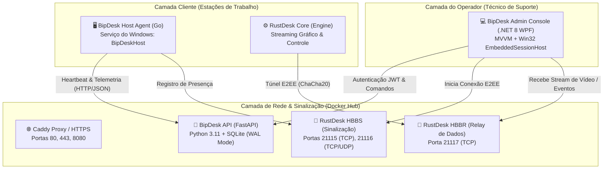

# 📘 ESPECIFICAÇÃO TÉCNICA E ARQUITETURA COMPLETA — BIPDESK

> **Versão:** 2.1.2 Enterprise  
> **Data de Atualização:** Outubro de 2026  
> **Classificação:** Documentação Técnica Arquitetural & Inventário de Projeto  
> **Plataforma Suportada:** Windows (Agente e Console Técnico) / Linux ou Windows Container (Servidor Central)

---

## 1. 🎯 Visão Geral e Propósito do Sistema

O **BipDesk** é uma solução corporativa completa e auto-hospedada (*self-hosted*) para **Acesso Remoto, Suporte Técnico, Telemetria de Hardware e Gestão de Ativos de TI**. 

Projetado para operar em substituição a ferramentas comerciais licenciadas (como *TeamViewer*, *AnyDesk* e *Splashtop*), o BipDesk oferece **total soberania sobre os dados**, garantindo que as sessões de suporte, credenciais, conexões e métricas dos computadores trafeguem exclusivamente pela infraestrutura do próprio administrador, sem intermediação de nuvens de terceiros ou custos recorrentes de assinatura.

### Diferenciais Centrais do BipDesk:
1. **Desktop Nativo Puro**: O console do operador técnico é desenvolvido em **C# / .NET 8 WPF**, proporcionando altíssima performance gráfica, integração com chamadas Win32 e baixa utilização de recursos do sistema operacional.
2. **Agente Leve e Silencioso**: O agente cliente é compilado em **Go estático**, executando como serviço nativo do Windows em segundo plano, sem demandar instalação prévia de runtimes ou dependências de terceiros.
3. **Telemetria de Baixo Nível em Tempo Real**: Coleta de uso de CPU, alocação de Memória RAM, espaço livre em disco C: e modelo de processador diretamente via **Win32 API (Kernel32.dll)**.
4. **Sessão Acoplada (Sem Abas Externas Soltas)**: O display da estação remota é renderizado diretamente dentro da janela do aplicativo do técnico via manipulação Win32 `SetParent`, eliminando janelas secundárias soltas.
5. **Criptografia Ponta a Ponta (E2EE)**: Handshake e autenticação simétrica baseados em chaves assimétricas **Ed25519** e cifra **ChaCha20-Poly1305**.

---

## 2. 🏗️ Arquitetura Geral do Sistema (Os 4 Pilares)

O ecossistema do BipDesk é estruturado em 4 camadas desacopladas que operam em harmonia:



---

## 3. 📂 Mapeamento Físico de Pastas e Componentes

Abaixo está o inventário completo dos diretórios e arquivos que constituem o projeto:

```
d:/PROJETOS/BipDesk/
├── agent/                         # Código-fonte do Agente Cliente em Go
│   ├── bipdesk-agent.exe          # Binário compilado final do agente
│   ├── go.mod                     # Módulo Go
│   ├── icon.ico                   # Ícone oficial do executável
│   ├── main.go                    # Lógica principal, serviço Windows, telemetria e heartbeat
│   └── winres/                    # Recursos de manifesto e assinatura Windows
│
├── api/                           # Backend central em Python (FastAPI)
│   ├── Dockerfile                 # Construção da imagem Docker da API
│   ├── requirements.txt           # Dependências Python (FastAPI, SQLAlchemy, SlowAPI, etc.)
│   └── app/                       # Aplicação modular
│       ├── database.py            # Conexão SQLite com WAL mode e auto-migração de colunas
│       ├── main.py                # Rotas REST, schemas Pydantic, rate limit e concorrência
│       ├── models.py              # Entidades ORM (User, Machine, Command, Audit, Notes)
│       └── security.py            # Criptografia de senhas (bcrypt, Fernet AES-128, JWT)
│
├── client/                        # Componentes de suporte ao cliente RustDesk
│   ├── patches/                   # Patches e configurações de branding
│   └── resources/                 # Recursos gráficos e binários auxiliares
│
├── deploy/                        # Infraestrutura Docker e Scripts de Operação
│   ├── .env                       # Variáveis de ambiente (Segredos, chaves, senhas, portas)
│   ├── .env.example               # Modelo de variáveis de ambiente
│   ├── Caddyfile                  # Configuração do proxy reverso Caddy e entrega de downloads
│   ├── docker-compose.yml         # Orquestração dos 4 containers (API, Caddy, HBBS, HBBR)
│   ├── atualizar-duckdns.ps1      # Atualizador automático de IP dinâmico (DuckDNS)
│   ├── liberar-firewall.ps1       # Script de liberação das portas no Firewall do Windows
│   ├── start-server.ps1           # Inicializador do servidor Docker
│   ├── stop-server.ps1            # Finalizador do servidor Docker
│   ├── status-server.ps1          # Verificador de saúde e logs do servidor
│   ├── install-host.ps1           # Script PowerShell para instalação autônoma nos clientes
│   └── downloads/                 # Pasta servida pelo Caddy com instaladores prontos
│
├── dist/                          # Executáveis finais prontos para distribuição
│   ├── BipDesk_Admin.exe          # Console executável do Técnico (.NET 8 WPF)
│   ├── bipdesk-agent.exe          # Instalador/serviço do Agente para os computadores
│   └── BipDesk_Admin_Completo.zip # Pacote ZIP para distribuição da equipe técnica
│
├── docs/                          # Documentações do Projeto
│   ├── DEPLOY.md                  # Manual de implantação em servidores de produção
│   ├── VERSIONS.md                # Histórico de alterações e changelog
│   └── ESPECIFICACAO_TECNICA_BIPDESK.md # Este documento detalhado de arquitetura
│
└── tech-app/                      # Aplicação Desktop do Técnico (.NET 8 WPF)
    ├── App.xaml / App.xaml.cs     # Inicialização e ciclo de vida do WPF
    ├── BipDesk.Tech.csproj        # Manifesto do projeto C# .NET 8 (Windows Desktop)
    ├── Models/                    # Modelos de dados
    │   ├── ActiveSession.cs       # Controle de sessões remotas ativas em abas/dock
    │   └── Machine.cs             # Propriedades da máquina, telemetria, gauges e formatação
    ├── Services/                  # Camada de serviços e rede
    │   ├── ApiClient.cs           # Comunicação HTTP assíncrona com a API (JWT, poller, releases)
    │   ├── SessionLauncher.cs     # Preparação e orquestração da engine de streaming
    │   └── UpdateService.cs       # Verificação e download de novas versões
    ├── Styles/                    # Design System do BipDesk
    │   └── Theme.xaml             # Cores ergonômicas, botões modernos, scrollbars e progressbars
    ├── ViewModels/                # Camada ViewModel (MVVM)
    │   └── MainViewModel.cs       # Lógica do catálogo, filtros, subviews, comandos e polling
    └── Views/                     # Interfaces gráficas XAML e janelas Win32
        ├── EmbeddedSessionHost.cs # HwndHost para acoplamento Win32 da janela do RustDesk
        ├── EnrollDialog.xaml      # Janela para vinculação e cadastro de novo host
        ├── LoginWindow.xaml       # Tela de login corporativa do técnico
        ├── MainWindow.xaml        # Janela central com catálogo, cards, dock e visualizador
        ├── SendMessageDialog.xaml # Janela para envio de mensagens pop-up silenciosas
        └── TechniciansDialog.xaml # Janela de administração de operadores e permissões
```

---

## 4. ⚙️ Detalhamento dos Módulos

### 4.1. Pilar 1: Agente Host do Cliente (`agent/main.go`)

O agente do BipDesk é um utilitário desenvolvido em **Go 1.22+** que roda em estações de trabalho Windows como serviço ou processo em segundo plano.

#### Características Técnicas:
- **Gerenciador de Serviço Nativo**: Utiliza a biblioteca `golang.org/x/sys/windows/svc` para registrar e responder aos sinais do *Service Control Manager (SCM)* do Windows sob o nome `BipDeskHost`.
- **Telemetria Direta com Kernel32**:
  Para não sobrecarregar o host e evitar subprocessos lentos de WMI ou PowerShell, o agente faz chamadas diretas via DLL nativa do Windows:
  1. `GetSystemTimes`: Coleta tempo ocioso (*IdleTime*), tempo de kernel (*KernelTime*) e tempo de usuário (*UserTime*), calculando a carga real do processador entre intervalos.
  2. `GlobalMemoryStatusEx`: Lê a estrutura `MEMORYSTATUSEX` obtendo percentual de uso de RAM e memória física disponível.
  3. `GetDiskFreeSpaceExW`: Consulta os bytes livres da unidade raiz `C:\` e converte para Gigabytes.
  4. Identificador de CPU: Obtém o nome comercial do processador via variável de ambiente `PROCESSOR_IDENTIFIER` ou registro do sistema.
- **Heartbeat Periódico (Keep-Alive)**:
  A cada 30 segundos, envia um pacote JSON para `POST /api/agent/heartbeat`:
  ```json
  {
    "rustdesk_id": "987654321",
    "logged_in_user": "carlos.silva",
    "ip_address": "192.168.0.50",
    "cpu_usage": 24,
    "ram_usage": 52,
    "disk_free_gb": 180,
    "cpu_model": "Intel(R) Core(TM) i5-10400 CPU @ 2.90GHz"
  }
  ```
- **Execução de Comandos Silenciosos**:
  Durante a resposta do heartbeat, a API pode enviar instruções pendentes. O agente as executa de forma não interativa:
  - `cad`: Simula a combinação de teclas *Ctrl+Alt+Del* ou ativação do SAS de segurança do Windows.
  - `restart_spooler`: Executa reinicialização limpa do serviço `spoolsv` para destravar filas de impressão presas.
  - `flush_dns`: Executa `ipconfig /flushdns` limpando cache de resolução.
  - `lock`: Invoca `user32.dll!LockWorkStation` para proteger a sessão do usuário.
  - `reboot`: Invoca reinicialização controlada via `shutdown /r /t 5`.

---

### 4.2. Pilar 2: Backend da API Central (`api/app/`)

Construído sobre **FastAPI** e **SQLAlchemy**, operando com **Python 3.11** em container Docker.

#### Arquitetura de Banco de Dados:
- **Engine**: SQLite com **WAL Mode (Write-Ahead Logging)** ativado (`PRAGMA journal_mode=WAL`), permitindo leituras concorrentes ilimitadas enquanto operações de escrita ocorrem em microssegundos.
- **Auto-Migração (`database.py`)**: Rotina de inicialização que inspeciona a tabela `machines` no SQLite e adiciona dinamicamente colunas faltantes (`cpu_usage`, `ram_usage`, `disk_free_gb`, `cpu_model`) sem necessidade de migrações complexas via Alembic.

#### Modelagem de Entidades (`models.py`):
1. `User`: Usuários técnicos autorizados (campos: `id`, `username`, `password_hash`, `full_name`, `role` [admin/technician], `is_active`, `created_at`).
2. `Machine`: Computadores clientes cadastrados (campos: `id`, `rustdesk_id`, `hostname`, `alias`, `client_group`, `department`, `encrypted_password`, `notes`, `is_favorite`, `is_online`, `is_busy`, `busy_by`, `current_session_tech`, `session_started_at`, `logged_in_user`, `os_version`, `ip_address`, `last_seen_at`, `cpu_usage`, `ram_usage`, `disk_free_gb`, `cpu_model`).
3. `EnrollToken`: Tokens de convite para cadastramento seguro de novas estações.
4. `ConnectionAudit`: Rastreabilidade de conexões (quem conectou, em qual máquina, data/hora e duração).
5. `RemoteCommand`: Fila assíncrona de comandos remotos a serem consumidos pelo agente.
6. `MachineNote`: Histórico de anotações e ordens de serviço compartilhadas sobre cada máquina.

#### Camada de Criptografia e Segurança (`security.py`):
- **Senhas de Técnicos**: Criptografadas com `bcrypt` (fator de custo 12).
- **Senhas Autônomas das Máquinas**: Armazenadas com cifra simétrica **Fernet (AES-128-CBC + HMAC SHA256)**, derivando a chave a partir do `SECRET_KEY` do ambiente.
- **Tokens de Acesso**: **JWT (JSON Web Token)** assinado com HS256, expirando em 12 horas.
- **Rate Limiting**: Proteção com `SlowAPI` limitando endpoints sensíveis (ex: 15 tentativas/minuto no `/api/login`).

#### Integração Direta com o RustDesk Server (HBBS):
A função `get_registered_hbbs_peer_ids()` acessa em modo leitura o banco de dados interno do HBBS (`/server-keys/db_v2.sqlite3`). Com isso, a API só marca a máquina como verdadeiramente `Online` e autoriza a conexão se o agente estiver ativo simultaneamente no banco do BipDesk e registrado no servidor de sinalização RustDesk.

---

### 4.3. Pilar 3: Servidores de Sinalização e Relay (`deploy/`)

A camada de streaming e túnel utiliza a engine **RustDesk Server** rodando em containers Docker dedicados.

#### Componentes:
1. **HBBS (Rendezvous / Signaling Server)**:
   - Porta `21115 (TCP)`: Consulta de licença, teste de NAT e tipos de conexão.
   - Porta `21116 (TCP/UDP)`: Handshake STUN, registro de ID de máquinas e estabelecimento de canal P2P direto.
   - Chave Pública Ed25519: `id_ed25519.pub`, gerada no primeiro boot e compartilhada com técnicos e clientes.
2. **HBBR (Relay Server)**:
   - Porta `21117 (TCP)`: Canal de retransmissão de alta velocidade. Quando dois computadores estão sob CGNAT estrito ou firewalls que bloqueiam conexão direta P2P, o tráfego de vídeo e comandos é transmitido em túnel seguro através do HBBR.
3. **Caddy (Reverse Proxy & Web Server)**:
   - Recebe requisições HTTP na porta `8080` (ou 80/443 com certificado TLS automático).
   - Roteia `/api/*` diretamente para o container `bipdesk-api`.
   - Roteia `/downloads/*` para os instaladores pré-configurados do agente cliente.

---

### 4.4. Pilar 4: Console do Técnico Desktop (`tech-app/`)

O aplicativo do técnico é o centro operacional do BipDesk, concebido para oferecer uma experiência de uso profissional e ergonômica.

#### Design System & Ergonomia Visual (`Theme.xaml`):
- **Paleta Pro Soft Slate**:
  - Fundo principal: `#13161C` (evita fadiga ocular durante jornadas longas de atendimento).
  - Superfícies e Cards: `#1B2028` com bordas sutis `#2A323F`.
  - Acentos de Destaque: Azul Real Corporativo `#3B82F6`, Verde Esmeralda `#10B981` e Âmbar de Alerta `#FBBF24`.
- **Gauges de Hardware Modernos (`ModernProgressBarStyle`)**:
  - Mini barras de progresso horizontais de 5px a 8px com cantos arredondados, indicando uso de CPU e RAM com variação dinâmica de cor.

#### Arquitetura MVVM (`MainViewModel.cs`):
- **Polling Reativo**: Temporizador assíncrono que consulta `/api/machines` e `/api/groups` a cada 5 segundos para refletir novas máquinas, status online/offline, métricas de CPU/RAM e bloqueios de sessão sem congelar a interface.
- **Mecanismo Anti-Concorrência**:
  - Se outro técnico conectar na mesma máquina, o card exibe uma tarja âmbar: `⚠️ Em atendimento por @admin`.
  - Botão **"Liberar"**: Dispara `POST /api/machines/{id}/release`, permitindo desbloquear a estação caso a sessão anterior tenha caído incorretamente.
- **Resumo do Parque no Rodapé**:
  - Contadores rápidos com o total de máquinas, quantidade online e quantidade em atendimento ativo.

#### O Segredo da Sessão Acoplada (`EmbeddedSessionHost.cs`):
Diferente de alternativas que abrem janelas pop-up soltas ou navegadores web lentos, o BipDesk acopla a janela gráfica nativa do RustDesk diretamente dentro da tela do WPF:
1. Herda da classe de baixo nível `System.Windows.Interop.HwndHost`.
2. Cria um contêiner Win32 com `CreateWindowEx`.
3. Inicia o processo cliente passando os parâmetros de conexão silenciosa (`--connect <id> --password <pwd> --server <domain>`).
4. Localiza o identificador de janela (`HWND`) do processo e executa a chamada nativa:
   ```csharp
   SetParent(targetHwnd, this.Handle);
   SetWindowLong(targetHwnd, GWL_STYLE, WS_CHILD | WS_VISIBLE);
   ```
5. Remove bordas e barras de título do Windows e ancora o display 100% responsivo ao redimensionamento do console WPF.

#### Alternador de Subviews na Toolbar da Sessão:
- **`[🖥️ Área de Trabalho]`**: Exibe a tela gráfica do computador remoto com controle fluido de mouse e teclado.
- **`[⚡ Diagnóstico]`**: Oculta temporariamente o fluxo gráfico Win32 e renderiza o painel completo de diagnóstico:
  - Ficha de Processador (Nome do CPU e uso em tempo real).
  - Ficha de Memória RAM (Percentual de alocação física).
  - Ficha de Armazenamento (Espaço livre no disco C:).
  - Ficha de Criptografia & Túnel (Chave Ed25519, cifras ativas, IPs e portas de HBBS/HBBR).
  - Ações Rápidas de Manutenção (Ctrl+Alt+Del silencioso, reiniciar spooler, limpar DNS, bloquear estação e reboot).

---

## 5. 🌐 Matriz de Portas de Rede e Comunicação

| Porta | Protocolo | Direção | Serviço Responsável | Finalidade |
|---|---|---|---|---|
| **8080** | TCP | Entrada | Caddy / FastAPI | API REST, Autenticação, Heartbeat e Downloads |
| **21115** | TCP | Entrada | RustDesk HBBS | Teste de NAT, Tipo de Conexão e Negociação |
| **21116** | TCP/UDP | Entrada | RustDesk HBBS | Handshake STUN, Sinalização e Conexão P2P |
| **21117** | TCP | Entrada | RustDesk HBBR | Túnel Relay de Vídeo e Controle de Alta Velocidade |
| **21118** | TCP | Opcional | RustDesk HBBS | Conexões de cliente via WebSockets |
| **21119** | TCP | Opcional | RustDesk HBBR | Relay de dados via WebSockets |

---

## 6. 🛠️ Scripts Operacionais e Automação (`deploy/`)

Para garantir que o servidor opere sem complexidade operacional no Windows particular do usuário ou em servidores dedicados, foram desenvolvidos scripts PowerShell especializados:

1. **`start-server.ps1`**:
   Sobe toda a pilha Docker com garantia de portas liberadas (`docker compose up -d`).
2. **`stop-server.ps1`**:
   Encerra os containers do BipDesk de maneira graciosa sem corromper o banco de dados (`docker compose down`).
3. **`status-server.ps1`**:
   Exibe o status de cada um dos 4 containers, uso de memória, portas ativas e últimas linhas de log de cada serviço.
4. **`liberar-firewall.ps1`**:
   Cria regras automáticas no Firewall do Windows Defender liberando as portas `8080, 21115, 21116, 21117` tanto em TCP quanto em UDP.
5. **`atualizar-duckdns.ps1`**:
   Sincroniza o IP público da máquina com o subdomínio `bipdesk.duckdns.org`, permitindo que o BipDesk continue funcionando ininterruptamente mesmo com IPs dinâmicos de operadoras residenciais (Claro, Vivo, etc.).
6. **`install-host.ps1`**:
   Script executado na máquina do cliente para instalação com 1 linha de comando:
   - Baixa o `bipdesk-agent.exe`.
   - Configura as chaves públicas do servidor no registro do Windows.
   - Instala e inicia o serviço `BipDeskHost` de inicialização automática.

---

## 7. 🔒 Conformidade de Segurança e Privacidade

- **Sem Telemetria Oculta**: Todo o código-fonte está presente no repositório. Não há envio de métricas para a Microsoft, RustDesk público ou qualquer provedor em nuvem.
- **Isolamento de Conexão**: As estações de trabalho dos clientes comunicam-se exclusivamente com o servidor central configurado no `.env` (`bipdesk.duckdns.org` ou IP fixo).
- **Trilha de Auditoria**: Cada conexão aberta por um operador registra no banco de dados quem acessou, a máquina de destino, data, hora inicial e endereço IP.
- **Zero Senhas em Texto Claro**: Todas as senhas autônomas de máquinas clientes salvas no banco são criptografadas com chave AES-128 simétrica rotacionável.

---

## 8. 📊 Conclusão

O **BipDesk** combina a performance de código compilado de baixo nível (**Go** e **C# WPF**) com a flexibilidade de APIs modernas (**FastAPI**), atingindo uma solução de controle remoto corporativo de nível comercial, com custo zero de licenciamento, autonomia total e telemetria de hardware avançada.
